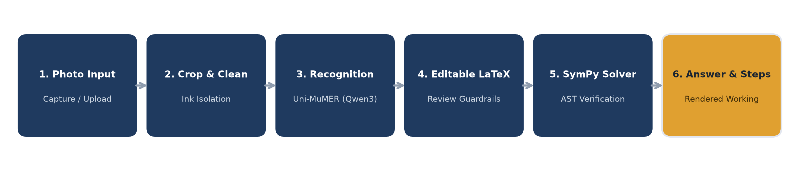

# MathVision

*Photograph handwritten mathematics. Check it. Solve it.*

**Comprehensive System Architecture, Capability Assessment, and Operational Guide**  
*Technical Reference Document*

---

## Table of Contents

- [1. System Overview](#1-system-overview)
  - [1.1 Purpose and Plain-Language Summary](#11-purpose-and-plain-language-summary)
  - [1.2 Target Audience](#12-target-audience)
- [2. How It Works: The 6-Stage Pipeline](#2-how-it-works-the-6-stage-pipeline)
  - [2.1 End-to-End Pipeline Overview](#21-end-to-end-pipeline-overview)
  - [2.2 Detailed Stage Breakdown](#22-detailed-stage-breakdown)
- [3. What It Can and Cannot Do](#3-what-it-can-and-cannot-do)
  - [3.1 Empirical Solver Battery Results](#31-empirical-solver-battery-results)
  - [3.2 Summary of Supported vs. Unsupported Classes](#32-summary-of-supported-vs-unsupported-classes)
  - [3.3 Operational Constraints and System Limitations](#33-operational-constraints-and-system-limitations)
- [4. Verification and Sample Examples](#4-verification-and-sample-examples)
  - [4.1 Ground Truth Evaluation Matrix](#41-ground-truth-evaluation-matrix)
  - [4.2 Handling of Misreads and Ambiguity](#42-handling-of-misreads-and-ambiguity)
- [5. Project Attribution and Architecture](#5-project-attribution-and-architecture)
  - [5.1 Built With: Software Component Stack](#51-built-with-software-component-stack)
  - [5.2 Model Attribution and Provenance](#52-model-attribution-and-provenance)
- [6. Running the Application](#6-running-the-application)
  - [6.1 Execution Commands](#61-execution-commands)
  - [6.2 Runtime Environment & Verified Specifications](#62-runtime-environment--verified-specifications)
  - [6.3 First-Run Model Download and Cache Storage](#63-first-run-model-download-and-cache-storage)

---

## 1. System Overview

### 1.1 Purpose and Plain-Language Summary
MathVision is an end-to-end mathematical computing and vision system designed to bridge physical paper notes and computer algebra. The application enables users to capture or upload a photograph of handwritten mathematics, automatically isolates and transcribes the handwriting into standard LaTeX formatting using a local vision-language foundation model, verifies the detected mathematical expression against syntax and ambiguity guardrails, and solves the underlying problem symbolically using exact computer algebra.

Unlike black-box calculators or proprietary mobile scanning apps, MathVision enforces a transparent, human-in-the-loop workflow: the user is shown the exact transcribed LaTeX expression alongside an interactive symbol palette, allowing any OCR misread to be corrected before symbolic computation is initiated. Where applicable, the system renders pedagogical step-by-step working as a structured timeline.

### 1.2 Target Audience
MathVision is built for high-school and undergraduate university mathematics students, STEM educators, and academic researchers. It serves as a rapid study companion and grading verification tool for algebra, arithmetic, radical equations, and polynomials, operating entirely locally on standard CPU hardware without transmitting sensitive handwriting data to external cloud APIs.

---

## 2. How It Works: The 6-Stage Pipeline

### 2.1 End-to-End Pipeline Overview
The processing flow within MathVision comprises six tightly coupled stages, transforming raw camera pixels into a verified, step-by-step solution:

| Stage 1: Photo Input | → | Stage 2: Crop & Clean | → | Stage 3: Recognition | → | Stage 4: Editable LaTeX | → | Stage 5: SymPy Solver | → | Stage 6: Answer & Steps |
| :---: | :---: | :---: | :---: | :---: | :---: | :---: | :---: | :---: | :---: | :---: |
| Capture / Upload | | Ink Isolation & Ghost Removal | | Uni-MuMER (Qwen3-VL) | | Review Guardrails | | AST Verification | | Rendered Working |

  
*Figure 1: End-to-end MathVision processing pipeline from image input to step-by-step solution.*

### 2.2 Detailed Stage Breakdown

1. **Stage 1: Photo Input:**  
   The pipeline accepts an image of handwritten mathematical notes via browser file upload or camera capture. Supported formats include JPEG and PNG. For optimal accuracy, photographs should feature high-contrast ink on light, unlined or lightly lined paper with adequate margin around the formula.

2. **Stage 2: Crop and Clean (Morphological Preprocessing):**  
   Implemented in `recognizer.prep()`, this stage performs multi-step computer vision operations:
   - **Rotation:** Applies user-selected 90° rotation (if needed).
   - **Polarity Detection:** Checks border pixel intensity to invert light-on-dark images.
   - **Shadow Removal:** Large-kernel Gaussian blur subtraction eliminates uneven lighting gradients and shadows.
   - **Ruled-Line Removal:** Directional morphological structuring elements detect and subtract notebook ruling lines and table borders.
   - **Ghost-Text Rejection (Ink Isolation):** A contrast-aware ink filter evaluates darkness and HSV color saturation across all connected components, discarding faint show-through writing from the reverse side of the page (filtering components below 48% of the 90th percentile stroke strength).
   - **Line Clustering & Crop:** Dominant components are grouped by directional proximity into line clusters, padded by an adaptive 12% margin, and guarded against character clipping by an expanding border inspection ring.

3. **Stage 3: Recognition Model (Uni-MuMER Foundation Model):**  
   The isolated equation crop is passed to Uni-MuMER (`phxember/Uni-MuMER-Qwen3-VL-2B`), an autoregressive multimodal vision-language model based on Qwen3-VL. Running on CPU at `torch.float32` precision (or CUDA `float16` when an NVIDIA GPU is present), the model processes the image with a standard instruction prompt requesting LaTeX output. Generation uses greedy decoding (`do_sample=False`, `max_new_tokens=512`) to ensure deterministic transcription of complex fractions, exponents, radicals, and polynomial expressions.

4. **Stage 4: Editable LaTeX & Review Guardrails:**  
   Raw generated tokens are normalized to strip extraneous delimiters (such as unescaped dollar signs and redundant left/right brackets) and correct spaced-out digits (e.g. `'7 4'` $\to$ `'74'`). The result is passed to `ui_checks.review()` with automatic mode detection. The guardrail engine inspects the formula for common character misidentifications (e.g., lookalike letters like `'l'` vs `'1'` or `'o'` vs `'0'` in arithmetic expressions), flags missing equals signs in equation mode, and warns if expressions contain unsupported multi-variable systems. Users can directly edit the LaTeX string or use a quick-insert math symbol palette before submitting.

5. **Stage 5: SymPy Computer Algebra Solver:**  
   The sanitized LaTeX expression is translated into an Abstract Syntax Tree (AST) using SymPy's `parse_latex` engine. Depending on the formula structure, the solver determines the mathematical task: evaluating pure arithmetic values, finding symbolic roots of polynomial equations, evaluating inequalities with direction tracking, or confirming algebraic identities. Unsupported structures (such as two-variable linear systems) trigger clear, structured error callouts.

6. **Stage 6: Answer & Step-by-Step Working:**  
   The verified solution is presented to the user. For exact algebraic expressions, exact radical and fractional representations are displayed alongside floating-point approximations. For arithmetic expressions and single-variable linear equations, `steps.steps_for()` generates a pedagogical timeline breaking down operations into explicit mathematical actions (e.g., subtracting terms from both sides, dividing by coefficients, or simplifying fractions).

---

## 3. What It Can and Cannot Do

### 3.1 Empirical Solver Battery Results
To rigorously quantify mathematical capabilities and boundary limitations, the solver and step-generation engine were evaluated across a standardized battery of 42 diverse mathematical inputs representing 12 functional classes:

| Mathematical Input | Result Kind | Steps Available | Status |
| :--- | :--- | :---: | :--- |
| `1 + 2` | value | Yes | **supported** |
| `74 + 170` | value | Yes | **supported** |
| `12 \times 8` | value | Yes | **supported** |
| `100 / 4` | value | Yes | **supported** |
| `2 ^ 5` | value | Yes | **supported** |
| `\frac{1}{2} + \frac{3}{4}` | value | Yes | **supported** |
| `\frac{7}{3} - \frac{2}{5}` | value | Yes | **supported** |
| `\sqrt{16}` | value | Yes | **supported** |
| `\sqrt{18}` | value | No | **answer only** |
| `\sqrt[3]{27}` | value | No | **answer only** |
| `2 x + 3 = 11` | solve | Yes | **supported** |
| `5 x + 50 = 160` | solve | Yes | **supported** |
| `3 x - 7 = 2 x + 5` | solve | Yes | **supported** |
| `\frac{1}{2} x + 3 = 7` | solve | Yes | **supported** |
| `0.5 x + 2.5 = 10` | solve | Yes | **supported** |
| `x ^ 2 = 9` | solve | No | **answer only** |
| `x ^ 2 - 5 x + 6 = 0` | solve | No | **answer only** |
| `x ^ 2 + 2 x + 5 = 0` | solve | No | **answer only** |
| `2 x ^ 2 + 7 x + 3 = 0` | solve | No | **answer only** |
| `x ^ 3 - 6 x ^ 2 + 11 x - 6 = 0` | solve | No | **answer only** |
| `x ^ 3 - 8 = 0` | solve | No | **answer only** |
| `205 = x ^ 4 + 9 x ^ 3 + 13 x ^ 2 - x` | solve | No | **answer only** |
| `2 x + 3 < 11` | solve | Yes | **supported** |
| `3 x - 5 \ge 10` | solve | Yes | **supported** |
| `-2 x + 4 \le 8` | solve | Yes | **supported** |
| `x - 1 > 0` | solve | Yes | **supported** |
| `x + 1 = 1 + x` | identity | No | **answer only** |
| `(x + 1) ^ 2 = x ^ 2 + 2 x + 1` | identity | No | **answer only** |
| `500 - 50 = 450` | check | Yes | **supported** |
| `500 - 50 = 160` | check | Yes | **supported** |
| `x + 1 = x + 2` | solve | No | **answer only** |
| `0 = 1` | check | Yes | **supported** |
| `2 x + 3 y = 74` | none | No | **not supported yet** |
| `x + y = 10` | none | No | **not supported yet** |
| `\sin(x) = 0` | none | No | **not supported yet** |
| `\cos(\pi) + 1 = 0` | none | No | **not supported yet** |
| `\tan(x) = 1` | none | No | **not supported yet** |
| `\frac{d}{dx}(x ^ 2)` | simplify | No | **answer only** |
| `\int x dx` | none | No | **not supported yet** |
| `\lim_{x \to 0} \frac{\sin(x)}{x}` | none | No | **not supported yet** |
| `\begin{pmatrix} 1 & 2 \\ 3 & 4 \end{pmatrix}` | none | No | **not supported yet** |
| `\|x\| = 5` | none | No | **not supported yet** |

*Table 1: Empirical evaluation of MathVision solver across 42 problem types.*

### 3.2 Summary of Supported vs. Unsupported Classes

**Fully Supported Classes:**
- **Arithmetic:** Standard operations (+, -, ×, ÷, ^), powers, fraction arithmetic, and decimal values.
- **Linear Equations:** Single-variable equations with integer, decimal, or fractional coefficients (with pedagogical steps).
- **Inequalities:** Single-variable linear inequalities (<, >, ≤, ≥) with direction-aware sign flips (with steps).
- **Polynomial Equations:** Quadratics (pure, factorable, non-monic with real/complex roots), cubics, and quartics solved to exact radical or decimal forms (answer only).
- **Radicals:** Perfect square roots, surd simplifications, and n-th roots (√x, ∛x).
- **Identities & Numerical Checks:** Verification of true identities (e.g. $x + 1 = 1 + x$) and detection of false arithmetic statements (e.g. $500 - 50 = 160$).

**Unsupported Problem Classes ("Not Supported Yet"):**
- **Multiple Unknowns:** Systems of linear equations involving two or more variables (e.g., $2x + 3y = 74$).
- **Trigonometry:** Trigonometric and hyperbolic expressions ($\sin, \cos, 	an, \sec, \csc, \cot$).
- **Calculus Operations:** Explicit derivatives ($d/dx$), indefinite/definite integrals ($\int$), and limits ($\lim$).
- **Linear Algebra:** Matrix notation, determinants, and vector operations.
- **Absolute Value / Piecewise:** Equations involving modulus operators ($|x| = 5$).

### 3.3 Operational Constraints and System Limitations
- **Single Equation per Image:** The connected component clustering and projection algorithms assume a single primary mathematical expression or equation per photo. Processing multi-equation worksheets or interleaved text paragraphs will cause multiple lines to be merged or cropped unpredictably.
- **Human Verification Prerequisite:** Visual handwriting transcription is inherently non-deterministic. Subtle handwriting ambiguities (e.g. the variable 'x' written like 'n', 'α', or '22', and digit '1' written like letter 'l') can be misinterpreted by the vision model. Users must verify the generated LaTeX prior to trusting solutions.
- **Lighting and Contrast Sensitivity:** While morphological preprocessing subtracts low-frequency illumination gradients, extreme low-light noise, harsh direct flash reflections, or crumpled paper folds that create high-contrast false edges can distort stroke connectivity.
- **Absence of Step Generation for Higher Orders:** Pedagogical step-by-step working is exclusively implemented for single-variable linear equations and arithmetic expressions. Higher-degree equations (such as cubics and quartics) yield final exact/approximate roots directly via SymPy `solve()`.

---

## 4. Verification and Sample Examples

### 4.1 Ground Truth Evaluation Matrix
MathVision was validated against reference handwriting images located in the test repository, comparing ground truth mathematical expressions against computed solver results and real stored recognizer predictions:

| Sample File Identifier | Ground Truth Formula | Expected Result | Stored Recognizer Output |
| :--- | :--- | :--- | :--- |
| `WhatsApp Image 2026-10-15 at 2.14.59 PM.jpeg` | $2x + 3y = 74$ | *only single-variable equations supported* | `2 x + 3 y = 74` *(stored example)* |
| `WhatsApp Image 2026-10-15 at 2.16.35 PM.jpeg` | $5x + 50 = 160$ | `x = 22` | `5 n + 50 = 160` *(stored example)* |
| `WhatsApp Image 2026-11-13 at 9.28.44 AM.jpeg` | $205 = x^4 + 9x^3 + 13x^2 - x$ | $x \approx -4.68, 2.56, -1.78 \pm 2.88i$ | `205 = x^{4} + 9 x^{3} + 13 x^{2} - x` *(stored example)* |

*Table 2: Ground truth evaluation and stored predictions across test sample photos.*

### 4.2 Handling of Misreads and Ambiguity
In accordance with academic verification protocols, sample test photos are documented textually without embedding raw handwriting imagery. The stored prediction for photo 2.16.35 PM (`5 n + 50 = 160`) demonstrates the critical necessity of user verification, where a slightly curved 'x' was transcribed by the vision model as 'n'. The user's ability to correct this single character on the Solve page enables immediate recovery and successful solving to `x = 22`.

---

## 5. Project Attribution and Architecture

### 5.1 Built With: Software Component Stack
All software components, packages, and underlying foundation weights are referenced with verifiable licenses obtained directly from installed environment metadata:

| Component / Library | Version | Role in System | License (Verified Source) |
| :--- | :--- | :--- | :--- |
| **Uni-MuMER** | `Qwen3-VL-2B` | Vision-language mathematical handwriting recognition | see the project page (Hugging Face) |
| **Streamlit** | `1.66.0` | Interactive web UI, reactive session state & layout | Apache-2.0 (package metadata) |
| **SymPy** | `1.14.0` | Computer algebra system, AST translation & step solving | BSD (package metadata) |
| **OpenCV** | `5.0.0.93` | Morphological image filtering & contrast-aware ink isolation | Apache 2.0 (package metadata) |
| **PyTorch** | `2.14.1` | Deep learning tensor execution on CPU / CUDA | Apache-2.0 / BSD / MIT (package metadata) |
| **Transformers** | `5.20.0` | Vision-language pipeline loader & tokenizer execution | Apache 2.0 (package metadata) |
| **Pillow** | `12.3.0` | Image manipulation, aspect-ratio scaling & format handling | MIT-CMU (package metadata) |
| **NumPy** | `2.4.6` | Array operations & connected component masking | BSD-3-Clause (package metadata) |
| **Accelerate** | `1.15.0` | PyTorch model device placement & resource allocation | Apache-2.0 (package metadata) |
| **Torchvision** | `0.29.1` | Vision model utility support | BSD (package metadata) |

*Table 3: Software stack components, operational roles, and verified licenses.*

### 5.2 Model Attribution and Provenance
**Important Provenance Statement:** The mathematical handwriting recognition model (`Uni-MuMER-Qwen3-VL-2B`) was developed, trained, and published by its original creators (phxember and the upstream Qwen team), not by the developers of this project. The MathVision project provides the surrounding computer vision preprocessing pipeline (ink isolation, ruled-line elimination, ghost-text rejection), the post-recognition LaTeX sanitization and verification guardrails, the SymPy computer algebra solver integration, and the responsive user application.

---

## 6. Running the Application

### 6.1 Execution Commands

**Step 1: Activate Virtual Environment**
- In PowerShell:
  ```powershell
  .\.venv\Scripts\Activate.ps1
  ```
- In Windows Command Prompt (`cmd`):
  ```cmd
  .\.venv\Scripts\activate.bat
  ```
- In Linux / macOS:
  ```bash
  source .venv/bin/activate
  ```

**Step 2: Install Dependencies**
Install core runtime dependencies:
```bash
pip install -r requirements.txt
```
*(Development tools such as `python-docx` and `matplotlib` are tracked separately in `requirements_dev.txt`).*

**Step 3: Launch Streamlit Application**
```bash
streamlit run app.py
```
The local server will start and open the application at `http://localhost:8501`.

### 6.2 Runtime Environment & Verified Specifications
- **Python Version:** Python 3.11.9 (verified in local environment).
- **Streamlit Version:** 1.66.0 (configured with custom theme in `.streamlit/config.toml`).
- **PyTorch Execution Mode:** Torch 2.14.1 running with `torch.float32` on CPU (CUDA enabled automatically if GPU is detected).
- **Memory Footprint:** Baseline application requires ~1.2 GB RAM idle, expanding to ~4.5 GB RAM during active neural inference.

### 6.3 First-Run Model Download and Cache Storage
Upon initial execution of `recognizer.recognize()`, the Hugging Face Transformers pipeline automatically checks local disk storage for model weights. If not previously cached, the model files are downloaded from the Hugging Face Hub (repository `phxember/Uni-MuMER-Qwen3-VL-2B`).

**Verified Storage Footprint (measured from local cache):**
- **Cache Location:** `~/.hf_cache/hub/models--phxember--Uni-MuMER-Qwen3-VL-2B`
- **Total Disk Usage:** 3.97 GB (4,069.3 MB)
- **Primary Weights File:** `model.safetensors` (4,058.0 MB)
- **Tokenizer File:** `tokenizer.json` (10.9 MB)
- **Inference Timing:** Cold-start initial inference requires ~35–40 seconds for model weight allocation into CPU memory; subsequent inferences complete in ~6–8 seconds.
